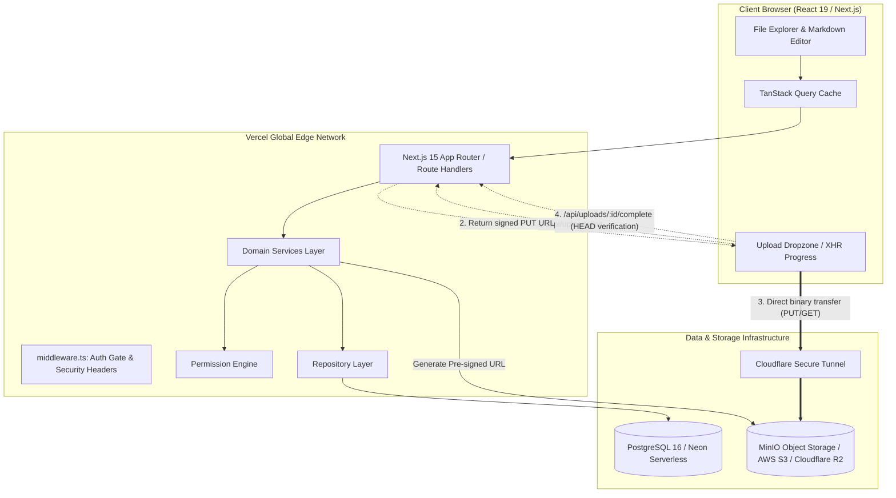
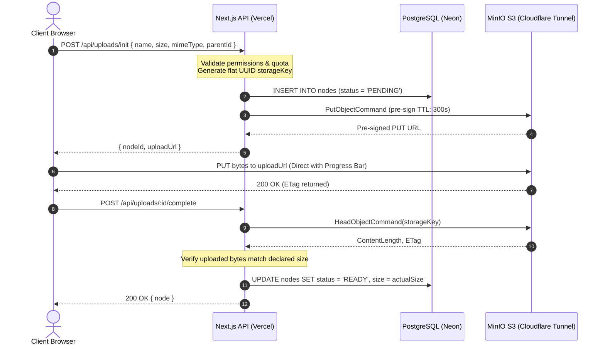

<div align="center">

# ⚡ Sharer (DriveLite)
### Enterprise-Grade Cloud Storage & Secure File Collaboration Suite

[](https://nextjs.org/)
[](https://react.dev/)
[](https://www.typescriptlang.org/)
[](https://tailwindcss.com/)
[](https://www.postgresql.org/)
[](https://www.prisma.io/)
[](https://min.io/)
[](https://www.docker.com/)

<p align="center">
  A high-throughput cloud storage platform engineered with <b>direct browser-to-storage pre-signed S3 transfers</b>, 
  <b>materialized path folder hierarchies</b>, <b>granular nearest-ancestor permission inheritance</b>, 
  and <b>unguessable 256-bit time-bound sharing</b>.
</p>

[Live Demo](#-deployment-architecture) • [System Architecture](#-system-architecture) • [Key Features](#-key-features) • [Quickstart](#-quickstart--local-development) • [Production Deployment](#-production-deployment-100-free)

</div>

---

## 🌟 Key Architectural Pillars

1. **Zero Server Byte Proxying**: Uploads and downloads stream directly between the client browser and S3 object storage via short-lived pre-signed cryptographic URLs. Next.js server memory footprint remains flat ($< 80\text{ MB}$) even during concurrent 100 MB uploads.
2. **Materialized Path Tree Model**: Single-table composite `Node` pattern modeling folders and files to depth 50+. Resolves an entire 20-level hierarchy in a **single non-recursive query** ($< 2\text{ ms}$).
3. **Constant-Time Cycle Protection**: Subtree move validation runs in $O(1)$ string-prefix checks to prevent folder parenting loops. Subtree paths rewrite atomically via single SQL string substitution.
4. **Transactional Outbox for Storage Deletions**: Eliminates orphaned S3 objects across distributed PostgreSQL and S3 transactions. Deletions queue in a transactional outbox and drain asynchronously.
5. **Centralized Permission Matrix**: Strict server-enforced role hierarchy (`OWNER > EDITOR > VIEWER`) with nearest-ancestor inheritance and per-node overrides.

---

## 📐 System Architecture

### High-Level Topology



---

### Direct Pre-signed S3 Upload Lifecycle



---

## 📁 Materialized Path Composite Hierarchy

DriveLite stores both files and folders in a single `nodes` table using a materialized path string (e.g. `/root-id/folder-a-id/folder-b-id/`).

```
My Drive (root)                          [/]
├── Documents                            [/root/]
│   ├── Architecture.pdf                 [/root/docs/]
│   └── Notes.md                         [/root/docs/]
└── Projects                             [/root/]
    └── 2026                             [/root/projects/]
        └── Sprint.xlsx                  [/root/projects/2026/]
```

### Architectural Benefits

* **Zero Recursive Queries**: Discovering ancestors requires zero recursive CTEs:
  ```ts
  const ancestorIds = node.path.split("/").filter(Boolean);
  const ancestors = await prisma.node.findMany({ where: { id: { in: ancestorIds } } });
  ```
* **Instant Subtree Moves**: Moving a directory with 10,000 descendants updates in a single SQL operation:
  ```sql
  UPDATE nodes
  SET path = :newPath || SUBSTRING(path FROM :oldPathLength + 1),
      depth = depth + :depthDelta
  WHERE path LIKE :oldPathPrefix AND id != :nodeId;
  ```
* **$O(1)$ Cycle Protection**:
  ```ts
  if (destinationFolder.path.startsWith(sourceFolder.path)) {
    throw new BadRequestError("Cannot move a folder into its own subfolder");
  }
  ```

---

## 🔐 Permission & Sharing Matrix

Access is enforced exclusively in the server layer (`src/server/permissions/`):

| Action | OWNER | EDITOR | VIEWER | Public Link (VIEW) | Public Link (EDIT) |
| :--- | :---: | :---: | :---: | :---: | :---: |
| **List folder / Read metadata** | ✅ | ✅ | ✅ | ✅ | ✅ |
| **Download file bytes** | ✅ | ✅ | ✅ | ✅ | ✅ |
| **Upload file / Create subfolder** | ✅ | ✅ | ❌ | ❌ | ✅ |
| **In-app text/markdown edit** | ✅ | ✅ | ❌ | ❌ | ✅ |
| **Rename / Move node** | ✅ | ✅ | ❌ | ❌ | ❌ |
| **Soft delete (Move to Trash)** | ✅ | ✅ | ❌ | ❌ | ❌ |
| **Manage users / Share grants** | ✅ | ❌ | ❌ | ❌ | ❌ |
| **Permanent Purge / Restore** | ✅ | ❌ | ❌ | ❌ | ❌ |

---

## 🛠️ Tech Stack

### Core Framework & Frontend
* **[Next.js 15.5](https://nextjs.org)**: App Router, React Server Components, Turbopack, Streaming SSR.
* **[React 19](https://react.dev)**: Client components, progressive form handling.
* **[Tailwind CSS v4](https://tailwindcss.com)**: Modern styling system with native dark/light theme switching.
* **[Lucide React](https://lucide.dev)**: UI iconography.
* **[TanStack Query v5](https://tanstack.com/query)**: Reactive client-side cache and asynchronous state management.

### Backend & Storage
* **[PostgreSQL 16](https://www.postgresql.org)**: ACID-compliant relational metadata store.
* **[Prisma ORM 6.19](https://www.prisma.io)**: Type-safe database queries, migrations, and connection pooling.
* **[MinIO S3 / AWS SDK v3](https://min.io)**: S3-compliant object store with flat UUID keys (`crypto.randomUUID()`).
* **[Cloudflare Tunnel](https://developers.cloudflare.com/cloudflare-one/connections/connect-networks/)**: Zero-trust edge tunneling with free automated SSL.

### Security & Cryptography
* **[@node-rs/argon2](https://github.com/napi-rs/node-rs)**: Hardened Argon2id password hashing.
* **[jose](https://github.com/panva/jose)**: Edge-ready signed JWT session tokens in `HttpOnly`, `SameSite=Lax` cookies.
* **[Zod](https://zod.dev)**: Strict runtime schema validation on every API endpoint.

---

## 🚀 Quickstart — Local Development

### Prerequisites
* **Node.js**: v20 or higher
* **Docker & Docker Compose**: Installed and running

### 1. Clone & Install Dependencies
```bash
git clone https://github.com/Plash-Sharma/Sharer.git
cd Sharer
npm install
```

### 2. Configure Environment
Copy the example environment configuration:
```bash
cp .env.example .env
```

### 3. Spin Up Infrastructure (PostgreSQL + MinIO)
```bash
npm run docker:up
```
This starts:
* **PostgreSQL**: Port `5433` (mapped from `5432`)
* **MinIO S3 API**: Port `9000`
* **MinIO Console**: Port `9001` (Credentials: `minioadmin` / `miniopassword123`)

### 4. Push Database Schema
```bash
npx prisma db push
```

### 5. Start Development Server
```bash
npm run dev
```
Open **[http://localhost:3000](http://localhost:3000)** in your browser.

---

## 🌍 Production Deployment (100% Free)

You can deploy Sharer to the public web with **zero monthly hosting fees**:

```
[Vercel Global Edge] <----> [Neon PostgreSQL]
        |
        v (Signed S3 URLs)
[Client Browser] <=== Cloudflare Tunnel ===> [Local Docker MinIO]
```

### 1. Provision Free Cloud Database (Neon)
1. Create a free PostgreSQL instance at **[Neon.tech](https://neon.tech)**.
2. Push your Prisma schema to Neon:
   ```bash
   DATABASE_URL="<your-neon-pooled-connection-string>" npx prisma db push
   ```

### 2. Expose Local MinIO via Cloudflare Tunnel
Expose your local MinIO port `9000` to the internet with free end-to-end SSL:
```bash
.\cloudflared.exe tunnel --url http://localhost:9000
```
Copy the generated HTTPS URL (e.g. `https://xxxx.trycloudflare.com`).

### 3. Deploy Frontend & API to Vercel
1. Import repository `Plash-Sharma/Sharer` on **[Vercel](https://vercel.com/new)**.
2. Add the following Environment Variables:

| Environment Variable | Production Value |
| :--- | :--- |
| `DATABASE_URL` | *Your Neon pooled connection string* |
| `NEXTAUTH_SECRET` | *32+ character random secret* |
| `S3_ENDPOINT` | `https://xxxx.trycloudflare.com` |
| `S3_PUBLIC_ENDPOINT` | `https://xxxx.trycloudflare.com` |
| `S3_REGION` | `us-east-1` |
| `S3_BUCKET` | `drivelite-files` |
| `S3_ACCESS_KEY` | `drivelite-app` |
| `S3_SECRET_KEY` | `drivelitesecret123` |
| `S3_FORCE_PATH_STYLE` | `true` |
| `MAX_UPLOAD_BYTES` | `104857600` *(100 MB)* |

3. Click **Deploy**.

---

## 🧪 Testing & Verification

Run the full suite of automated tests:

```bash
# Unit & integration tests (Vitest)
npm run test

# End-to-end S3 transfer verification (PUT/GET/HEAD/DELETE)
npm run smoke:s3

# Storage reconciler audit (detect DB vs S3 sync drifts)
npx tsx scripts/reconcile-storage.ts

# Production build check
npm run build
```

---

## 📜 Directory Structure

```text
Sharer/
├── prisma/
│   └── schema.prisma            # Database schema & indexes
├── public/                      # Static brand assets & icons
├── scripts/
│   ├── smoke-s3.ts              # End-to-end S3 verification suite
│   ├── reap-pending-uploads.ts  # Garbage collector for abandoned uploads
│   ├── reconcile-storage.ts     # DB vs S3 consistency auditor
│   └── run-storage-outbox.ts    # Transactional outbox S3 deletion worker
├── src/
│   ├── app/                     # Next.js 15 App Router pages & API routes
│   │   ├── (app)/drive/         # Core Explorer UI & folder hierarchy
│   │   ├── (auth)/              # Login and Register pages
│   │   └── api/                 # REST endpoints for nodes, shares, auth
│   ├── components/              # React components (FileTable, Editor, Dropzone)
│   ├── contexts/                # React context (Theme, state)
│   └── server/                  # Layered server-side domain logic
│       ├── db/                  # Prisma client singleton
│       ├── permissions/         # Central permission engine & role matrices
│       ├── repositories/        # Database access layer
│       ├── security/            # Argon2id, JWT, sanitization, rate-limiter
│       ├── services/            # Business logic (Upload, Node, Share, Auth)
│       └── storage/             # S3 storage provider & outbox worker
├── docker-compose.yml           # Local multi-container stack
├── Dockerfile                   # Next.js standalone container
└── Dockerfile.mc                # MinIO bucket init container
```

---

## ⚖️ License

Distributed under the **MIT License**. See `LICENSE` for more information.

---

<div align="center">
  <b>Built with high standards by <a href="https://github.com/Plash-Sharma">Plash Sharma</a></b>
</div>
