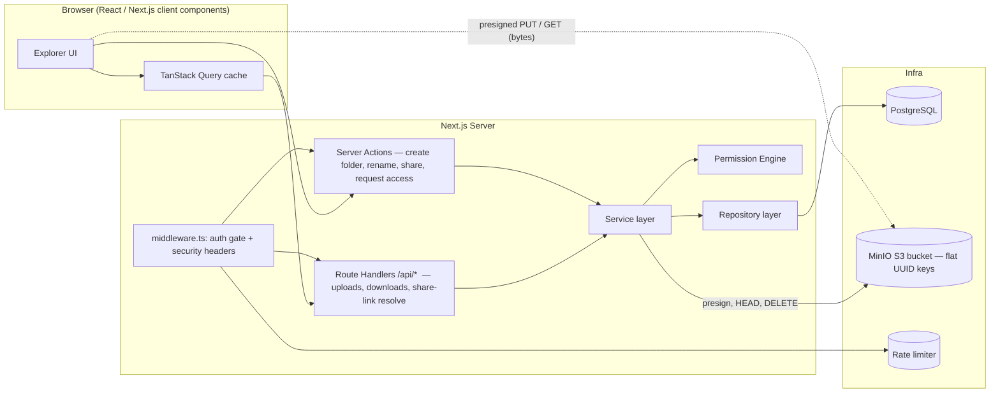
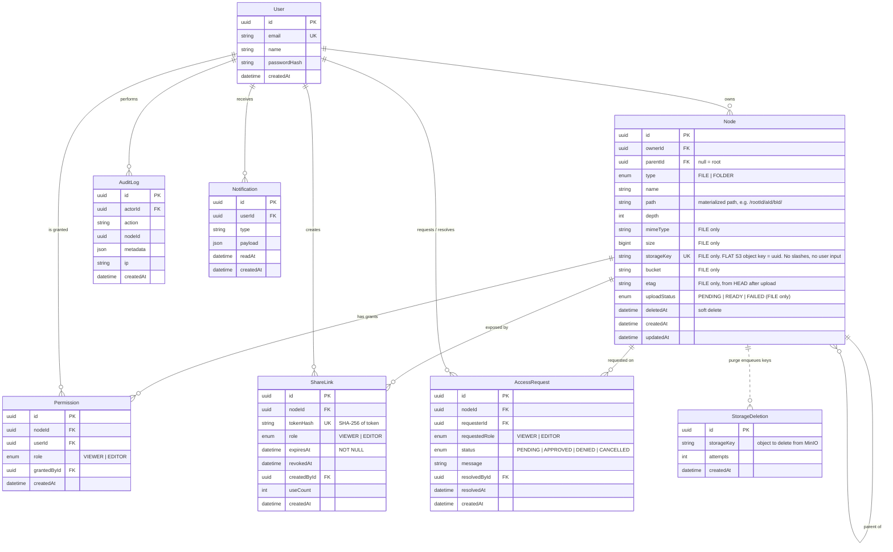
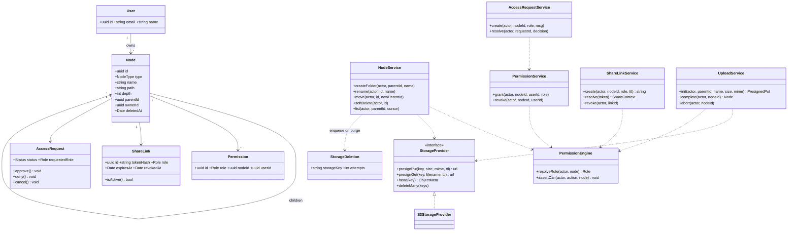
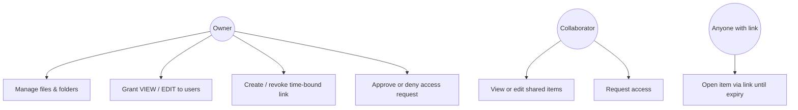
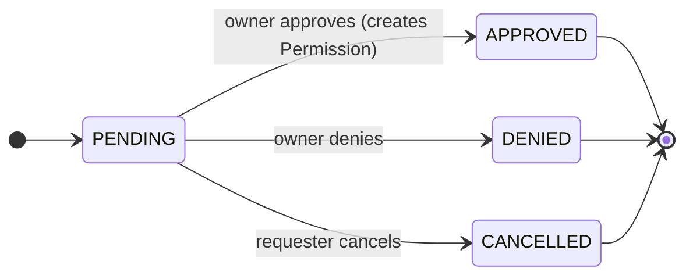
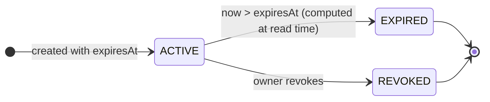
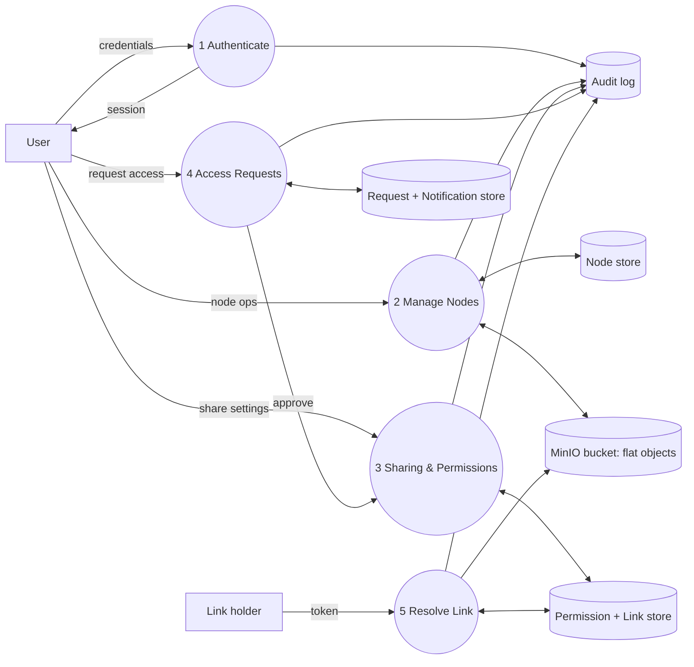
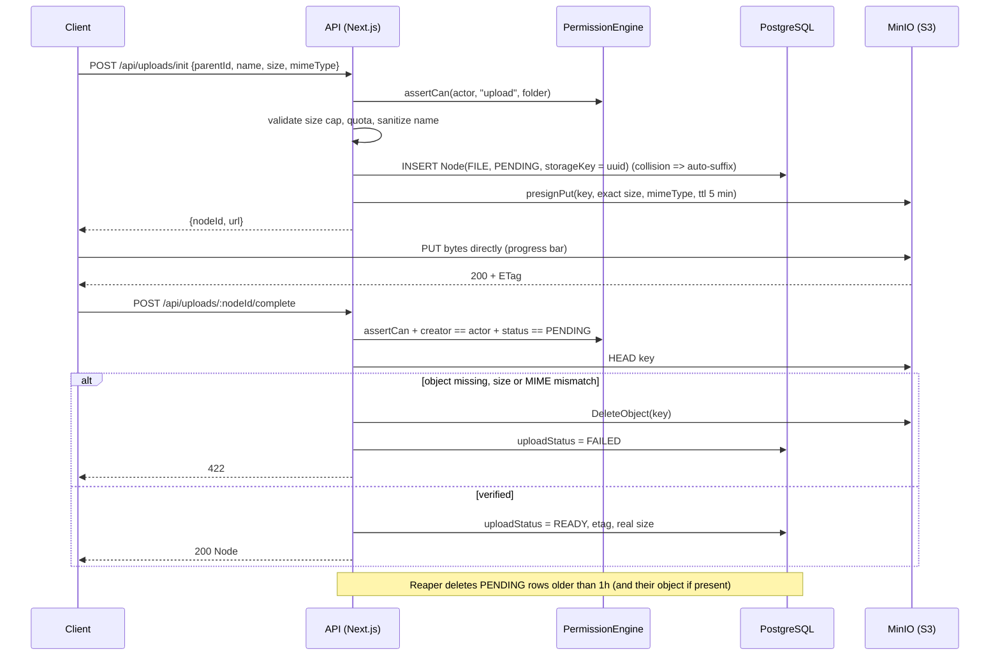
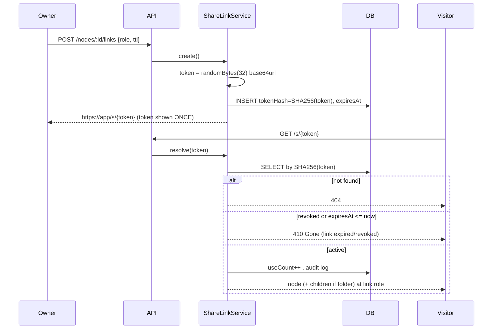
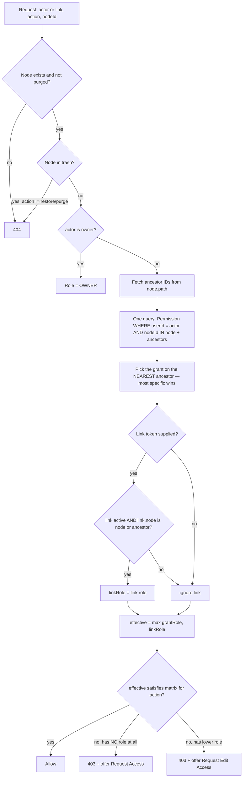

# ANTIGRAVITY MASTER PROMPT — "DriveLite": A Google-Drive-Style File Manager

> Paste everything below this line into Antigravity. Work phase by phase. Do NOT skip ahead. After each phase, run the verification checklist and stop for confirmation before starting the next phase.

---

## 0. ROLE & OPERATING RULES

You are a senior full-stack engineer and software architect. Build **DriveLite**, a Google-Drive-like web app, following a systematic Software Design (SD) process: requirements → architecture → data model → flows → implementation → hardening.

Rules:
1. Strict TypeScript (`"strict": true`, no `any`). Validate every external input with **Zod**.
2. Authorization is enforced on the **server**, in one central module (`src/server/permissions`). UI hiding of buttons is cosmetic only.
3. Layered architecture: `route handler / server action → service → repository → Prisma`. No Prisma calls inside components or route handlers.
4. Every phase ends with passing `tsc --noEmit`, `eslint`, and tests for that phase.
5. Keep a running `docs/DECISIONS.md` (ADR style) and update it whenever you make a non-obvious choice.
6. If a requirement is ambiguous, pick the safest option, document it in `docs/DECISIONS.md`, and continue.
7. **Storage rule:** file bytes live ONLY in a MinIO bucket (S3 API) under **flat UUID object keys**. Folder hierarchy exists ONLY in PostgreSQL. Never create "folder/" prefixes or marker objects in the bucket. Next.js never proxies file bytes — the browser talks to MinIO directly through short-lived pre-signed URLs.

---

## 1. PRODUCT REQUIREMENTS

### 1.1 Functional
| # | Requirement |
|---|-------------|
| F1 | Register / login / logout (email + password; Google OAuth optional) |
| F2 | Create folders; folders can contain folders to unlimited depth |
| F3 | Upload files; create new text/markdown files in-app; rename, move, delete (soft delete → trash → restore → purge) |
| F4 | Breadcrumb navigation, list/grid view, sorting, search by name |
| F5 | Share an item with specific users as **VIEWER** or **EDITOR** (owner manages grants) |
| F6 | Permissions on a folder are **inherited** by all descendants; a more specific grant on a descendant overrides inheritance |
| F7 | A user without access can **request** VIEW or EDIT access; owner approves/denies; requester is notified in-app |
| F8 | **Time-bound share links**: owner generates a link for a file/folder with role (VIEW/EDIT-optional), expiry (1h / 1d / 7d / 30d / custom), can revoke any time; expired/revoked links return a clear error |
| F9 | "Shared with me" and "Recently shared" views |
| F10 | Audit log of sensitive actions (share, revoke, approve, download via link) |

### 1.2 Non-functional
- Handles folders with 10,000+ children (pagination, indexes).
- Folder tree depth up to ~50 without recursion in application code.
- Uploads/downloads go **browser ↔ MinIO directly via pre-signed URLs** (Next.js never buffers or proxies file bytes). Single-PUT limit 100 MB (configurable); multipart is a documented future extension.
- Share link tokens are unguessable (≥256-bit) and stored hashed.
- OWASP Top-10 aware (IDOR, path traversal, XSS via file preview, CSRF, rate limiting).
- Storage is accessed only through the S3 API (`@aws-sdk/client-s3`). MinIO runs locally in Docker; moving to AWS S3 / R2 / GCS later must require **only env-var changes**.

### 1.3 Permission matrix (define in code as a single constant)
| Action | OWNER | EDITOR | VIEWER | Link(VIEW) | Link(EDIT) |
|---|---|---|---|---|---|
| View / list / download | ✅ | ✅ | ✅ | ✅ | ✅ |
| Rename / edit content / upload into folder | ✅ | ✅ | ❌ | ❌ | ✅ |
| Move / delete | ✅ | ✅ (not out of the shared root) | ❌ | ❌ | ❌ |
| Manage sharing, create links, approve requests | ✅ | ❌ | ❌ | ❌ | ❌ |

Role order: `VIEWER < EDITOR < OWNER`. Effective role = `max(direct grant, inherited grant, link role)`.

---

## 2. TECH STACK (fixed)

- **Next.js 15** (App Router) + **TypeScript** (strict)
- **PostgreSQL** + **Prisma ORM** (raw SQL via `$queryRaw` only for recursive CTEs)
- **Auth.js (NextAuth v5)** — Credentials (argon2id hashing via `@node-rs/argon2`) + optional Google
- **Zod** for validation, **TanStack Query** for client data, **Tailwind CSS + shadcn/ui**
- **Object storage**: **MinIO** (Docker, data persisted to local disk) via `@aws-sdk/client-s3` + `@aws-sdk/s3-request-presigner`, behind a `StorageProvider` interface (`S3StorageProvider`)
- **Rate limiting**: `@upstash/ratelimit` or an in-memory LRU fallback in dev
- **Testing**: Vitest (unit/service), Playwright (e2e)
- **Tooling**: ESLint, Prettier, Husky + lint-staged, Docker Compose (Postgres + MinIO + bucket bootstrap)

---

## 3. HIGH-LEVEL ARCHITECTURE



**Design principle:** one table (`Node`) models both files and folders (Composite pattern). Permissions, links, and requests all reference `Node`, so every feature works identically on files and folders.

**Storage principle (S3-style):** the bucket is a flat key→bytes store. The *logical* tree (names, parents, paths) is metadata in PostgreSQL; the *physical* object key is an opaque UUID. Consequently rename, move, and folder-delete never touch MinIO — they are pure DB operations.

---

## 4. DATA MODEL

### 4.1 ER diagram



### 4.2 Required constraints & indexes (put these in the Prisma migration)
- `Node`: unique `(parentId, name)` **where `deletedAt IS NULL`** (partial unique index via raw SQL migration; root uses `ownerId` + `parentId IS NULL`).
- `Node`: index `(ownerId, parentId)`, index `(path text_pattern_ops)` for prefix queries, index `(deletedAt)`.
- `Node`: **unique `(storageKey)`** (non-null for FILE); index `(uploadStatus, createdAt)` for the stale-PENDING reaper. All listing/search queries MUST filter `type = FOLDER OR uploadStatus = READY`.
- `StorageDeletion`: index `(createdAt)`; no FK to `Node` (rows must outlive the node).
- `Permission`: unique `(nodeId, userId)`; index `(userId)`.
- `ShareLink`: unique `(tokenHash)`; index `(nodeId)`, `(expiresAt)`.
- `AccessRequest`: **partial unique** `(nodeId, requesterId) WHERE status = 'PENDING'` (prevents duplicate pending requests under race conditions).
- All FKs `ON DELETE CASCADE` except `AuditLog` (keep history).

### 4.3 Tree strategy
Use **materialized path + depth** (`path = parent.path + id + '/'`).
- Descendants of X: `WHERE path LIKE X.path || '%'`.
- Ancestors of X: split `X.path` into IDs → single `WHERE id IN (...)` query. **No N+1 climbing.**
- Moving a folder = one `UPDATE ... SET path = replace(path, oldPrefix, newPrefix)` inside a transaction, plus **cycle check**: reject if `newParent.path` starts with `node.path`.

### 4.4 Object storage strategy (MinIO, flat like S3)
- **One private bucket** (`drivelite-files`), anonymous access disabled, no bucket policy exposing objects. Every byte read/write goes through a pre-signed URL minted **after** `assertCan`.
- **Object key = `crypto.randomUUID()`** (stored in `Node.storageKey`). Never derive keys from filenames, folder names, user ids, or paths. Original filename lives only in `Node.name` and is applied at download via `ResponseContentDisposition`.
- **Folders are DB rows only.** Do not write `folder/` marker objects or use key prefixes as hierarchy.
- **Objects are write-once (immutable).** Editing an in-app text file uploads a NEW object with a NEW key, then swaps `Node.storageKey` in a transaction (with an `updatedAt` check) and enqueues the old key into `StorageDeletion`. Rename/move never touch the bucket.
- **Deletes use a transactional outbox:** purge removes `Node` rows and inserts their `storageKey`s into `StorageDeletion` in the same DB transaction; a worker later calls `DeleteObjects` (≤1000 keys/batch), retrying on failure. This avoids orphaned objects and dangling rows.
- **Upload lifecycle:** `PENDING` (row + presigned URL issued) → client PUTs to MinIO → `complete` endpoint does `HEAD` to verify → `READY`. Stale `PENDING` rows (>1 h) are reaped (delete object if present, delete row).
- **Never trust client-declared size/MIME:** the `complete` step re-reads `ContentLength` (and magic bytes for the MIME check) from MinIO.

### 4.5 Docker Compose + env (create in Phase 1)
```yaml
# docker-compose.yml
services:
  postgres:
    image: postgres:16
    environment: { POSTGRES_USER: drivelite, POSTGRES_PASSWORD: drivelite, POSTGRES_DB: drivelite }
    ports: ["5432:5432"]
    volumes: ["./.data/postgres:/var/lib/postgresql/data"]

  minio:
    image: minio/minio:latest
    command: server /data --console-address ":9001"
    ports: ["9000:9000", "9001:9001"]          # 9000 = S3 API, 9001 = web console
    environment:
      MINIO_ROOT_USER: ${MINIO_ROOT_USER}
      MINIO_ROOT_PASSWORD: ${MINIO_ROOT_PASSWORD}
      MINIO_API_CORS_ALLOW_ORIGIN: "http://localhost:3000"   # browser PUT/GET directly to MinIO
    volumes: ["./.data/minio:/data"]            # files persist on your local disk (gitignore .data/)

  minio-init:                                   # one-shot bootstrap
    image: minio/mc:latest
    depends_on: [minio]
    environment:
      MINIO_ROOT_USER: ${MINIO_ROOT_USER}
      MINIO_ROOT_PASSWORD: ${MINIO_ROOT_PASSWORD}
      S3_ACCESS_KEY: ${S3_ACCESS_KEY}
      S3_SECRET_KEY: ${S3_SECRET_KEY}
      S3_BUCKET: ${S3_BUCKET}
    entrypoint: >
      /bin/sh -c "
      until mc alias set local http://minio:9000 $$MINIO_ROOT_USER $$MINIO_ROOT_PASSWORD; do sleep 1; done;
      mc mb --ignore-existing local/$$S3_BUCKET;
      mc anonymous set none local/$$S3_BUCKET;
      mc admin user add local $$S3_ACCESS_KEY $$S3_SECRET_KEY || true;
      mc admin policy attach local readwrite --user $$S3_ACCESS_KEY || true;
      "
```
> Improve on `readwrite`: create a custom policy limited to `arn:aws:s3:::drivelite-files/*` so the app credentials cannot touch other buckets. The app uses these credentials, **never the root user**.

```
# .env.example
MINIO_ROOT_USER=minioadmin
MINIO_ROOT_PASSWORD=change-me-min-8-chars
S3_ENDPOINT=http://localhost:9000          # used by the server SDK
S3_PUBLIC_ENDPOINT=http://localhost:9000   # host used inside pre-signed URLs (must be browser-reachable)
S3_REGION=us-east-1
S3_BUCKET=drivelite-files
S3_ACCESS_KEY=drivelite-app
S3_SECRET_KEY=change-me-too-min-8-chars
S3_FORCE_PATH_STYLE=true                   # required for MinIO
MAX_UPLOAD_BYTES=104857600
PRESIGN_PUT_TTL_SECONDS=300
PRESIGN_GET_TTL_SECONDS=60
```
> If Next.js itself runs inside Docker, `S3_ENDPOINT` becomes `http://minio:9000` but `S3_PUBLIC_ENDPOINT` must stay `http://localhost:9000` — otherwise signed URLs contain an unreachable hostname.

---

## 5. TARGET FILE ARCHITECTURE

```
drivelite/
├── docker-compose.yml                 # postgres + minio + minio-init
├── .data/                             # gitignored: minio + postgres volumes (your local files live here)
├── .env.example
├── prisma/
│   ├── schema.prisma
│   ├── migrations/                    # includes raw SQL for partial unique indexes
│   └── seed.ts
├── docs/
│   ├── DECISIONS.md
│   ├── ARCHITECTURE.md                # this prompt's diagrams, kept in sync
│   └── BOTTLENECKS.md
├── src/
│   ├── middleware.ts                  # auth gate, security headers, coarse rate limit
│   ├── app/
│   │   ├── (auth)/login/page.tsx
│   │   ├── (auth)/register/page.tsx
│   │   ├── (app)/layout.tsx           # sidebar + topbar
│   │   ├── (app)/drive/page.tsx                  # root "My Drive"
│   │   ├── (app)/drive/folders/[folderId]/page.tsx
│   │   ├── (app)/shared-with-me/page.tsx
│   │   ├── (app)/trash/page.tsx
│   │   ├── (app)/requests/page.tsx    # incoming + outgoing access requests
│   │   ├── s/[token]/page.tsx         # public share-link landing (no login required)
│   │   └── api/
│   │       ├── auth/[...nextauth]/route.ts
│   │       ├── nodes/route.ts                    # GET list (paginated), POST create folder/file
│   │       ├── nodes/[id]/route.ts               # GET meta, PATCH rename/move, DELETE soft-delete
│   │       ├── uploads/init/route.ts             # authz → create PENDING node → presigned PUT
│   │       ├── uploads/[nodeId]/complete/route.ts# HEAD object, verify → mark READY
│   │       ├── uploads/[nodeId]/abort/route.ts   # cancel: delete object + row
│   │       ├── nodes/[id]/download-url/route.ts  # authz → short-lived presigned GET
│   │       ├── nodes/[id]/content/route.ts       # in-app text files: small, server-side via SDK, new key per save
│   │       ├── nodes/[id]/permissions/route.ts   # GET/POST/PATCH/DELETE grants
│   │       ├── nodes/[id]/links/route.ts         # create/list/revoke share links
│   │       ├── nodes/[id]/requests/route.ts      # POST access request
│   │       ├── requests/[id]/route.ts            # PATCH approve/deny/cancel
│   │       └── share/[token]/(route|download-url)/route.ts  # resolve link + presigned GET
│   ├── components/
│   │   ├── explorer/ (FileTable, FolderTree, Breadcrumbs, NodeContextMenu, UploadDropzone)
│   │   ├── share/ (ShareDialog, LinkExpiryPicker, PermissionList, RequestAccessCard)
│   │   └── ui/                         # shadcn primitives
│   ├── server/
│   │   ├── auth/ (config.ts, password.ts, session.ts)
│   │   ├── db/prisma.ts                # singleton client
│   │   ├── permissions/
│   │   │   ├── roles.ts                # Role enum + order + matrix constant
│   │   │   ├── resolve.ts              # resolveEffectiveRole(user|link, node)
│   │   │   └── guard.ts                # assertCan(actor, action, node) → throws ForbiddenError
│   │   ├── services/
│   │   │   ├── node.service.ts
│   │   │   ├── upload.service.ts
│   │   │   ├── permission.service.ts
│   │   │   ├── sharelink.service.ts
│   │   │   ├── accessrequest.service.ts
│   │   │   ├── notification.service.ts
│   │   │   └── audit.service.ts
│   │   ├── repositories/ (node.repo.ts, permission.repo.ts, link.repo.ts, request.repo.ts)
│   │   ├── storage/ (s3.client.ts, StorageProvider.ts, S3StorageProvider.ts, keys.ts, presign.ts, outbox.worker.ts)
│   │   ├── security/ (token.ts, ratelimit.ts, sanitize-filename.ts, mime.ts)
│   │   └── errors.ts                   # AppError, ForbiddenError, NotFoundError, GoneError...
│   ├── lib/ (zod schemas, api-client, constants, utils)
│   └── types/
├── scripts/ (reconcile-storage.ts, reap-pending-uploads.ts, run-storage-outbox.ts)
└── tests/
    ├── unit/ (permissions.resolve.test.ts, sharelink.expiry.test.ts, node.move.cycle.test.ts)
    ├── integration/ (services against test DB)
    └── e2e/ (playwright: auth, folders, share link, access request)
```

---

## 6. UML DIAGRAMS

### 6.1 Class diagram (server domain)



### 6.2 Use-case overview



### 6.3 State machines




> Link status is **derived** (`revokedAt` / `expiresAt` vs `now()`), never relying on a cron job to flip a flag.

---

## 7. DATA FLOW DIAGRAMS

### 7.1 Level-1 DFD



### 7.2 Upload (sequence) — direct-to-MinIO, pre-signed



### 7.2b Download (sequence)

```mermaid
sequenceDiagram
  participant C as Client
  participant API as API (Next.js)
  participant G as PermissionEngine
  participant DB as PostgreSQL
  participant M as MinIO (S3)
  C->>API: GET /api/nodes/:id/download-url (or /api/share/:token/download-url)
  API->>G: assertCan(actor or link, "view", node)
  API->>DB: load storageKey, name, mimeType (uploadStatus must be READY)
  API->>M: presignGet(key, ttl = min(60s, link remaining life), ResponseContentDisposition = attachment; filename, ResponseContentType = safe type)
  API->>DB: audit log
  API-->>C: 200 {url}
  C->>M: GET url (bytes flow directly)
```

### 7.3 Share-link creation & access



### 7.4 Access request

```mermaid
sequenceDiagram
  participant U as Requester
  participant API as API
  participant RS as AccessRequestService
  participant DB as DB
  participant O as Owner
  U->>API: open item w/o access
  API-->>U: 403 + "Request access" CTA (no metadata leak beyond name/owner)
  U->>API: POST /nodes/:id/requests {role, message}
  API->>RS: create()
  RS->>DB: INSERT (partial unique prevents duplicate PENDING)
  RS->>DB: INSERT Notification(owner)
  O->>API: PATCH /requests/:id {decision}
  API->>RS: resolve()
  RS->>DB: tx { update request; if APPROVED upsert Permission }
  RS->>DB: INSERT Notification(requester)
```

---

## 8. CONTROL FLOW — PERMISSION RESOLUTION (the heart of the system)



Implementation notes:
- `resolveEffectiveRole` is a **pure function** over `(node, ancestors, grants, link, now)` so it is trivially unit-testable. Inject `now` for expiry tests.
- Return `404` (not `403`) for items the user has zero relationship with **only when** the product decision is to hide existence; otherwise `403` with a Request Access CTA. Choose `403 + CTA` and document it in DECISIONS.md.

---

## 9. STEP-BY-STEP IMPLEMENTATION PLAN

Execute sequentially. Each phase has **Deliverables** and a **Done-when** gate.

### Phase 1 — Foundation
- `create-next-app` (TS, App Router, Tailwind, ESLint), add shadcn/ui, Prisma, Zod, Vitest, Playwright.
- `docker-compose.yml` for Postgres + MinIO + `minio-init` (exactly as in Section 4.5); `.env.example`; singleton Prisma client; `s3.client.ts` (S3Client with `forcePathStyle: true`, separate public-endpoint presigner); `errors.ts` + a `handleApiError()` wrapper that maps `AppError` → JSON + status.
- **Done when:** `npm run dev` serves a page, DB connects, `npm run test` runs an empty suite, MinIO console opens at `localhost:9001`, the bucket exists and is private, and a scripted smoke test does presigned PUT → HEAD → presigned GET → DELETE using the **app** credentials.

### Phase 2 — Auth
- Prisma `User` (+ Auth.js tables if using adapter). Credentials provider with argon2id. Register/login pages, `middleware.ts` protecting `(app)` routes. `getCurrentUser()` helper that throws `UnauthorizedError`.
- **Done when:** register → login → protected page → logout works; wrong password is rate-limited (5/min/IP+email).

### Phase 3 — Node model & folder CRUD
- Prisma `Node` + raw-SQL migration for partial unique index & `path` index.
- `node.repo.ts`: `create`, `findById`, `listChildren(parentId, cursor, limit, sort)` (returns FOLDERs + FILEs with `uploadStatus = READY` only), `getAncestors(path)`, `moveSubtree`, `softDeleteSubtree` (single `UPDATE ... WHERE path LIKE`).
- `node.service.ts`: create folder, rename, move (with cycle check), soft-delete, restore, purge.
- UI: explorer page, breadcrumbs (from ancestors), sidebar tree (lazy-loaded per folder), context menu, create-folder dialog.
- **Done when:** nested folders to depth 10 work; moving a folder into its own child is rejected; name collision handled; unit tests for cycle check pass.

### Phase 4 — Files on MinIO (flat object storage)
- `StorageProvider` interface + `S3StorageProvider` (presignPut, presignGet, head, deleteMany). `keys.ts` exposes only `newStorageKey()` → `crypto.randomUUID()`; nothing else may construct keys.
- Upload flow exactly as in Section 7.2: `uploads/init` → browser PUT to MinIO → `uploads/:id/complete` (HEAD verify) → READY. `abort` endpoint + `reap-pending-uploads.ts` script for stale PENDING rows.
- Download flow as in Section 7.2b: `download-url` returns a ≤60 s presigned GET with forced `attachment` disposition (RFC 5987 `filename*` encoding) and a safe `ResponseContentType`.
- UI: `UploadDropzone` using `XMLHttpRequest` for real progress, max 3 parallel uploads, cancel button (calls `abort`).
- In-app `.md`/`.txt` files: save = write a NEW object (new UUID key) via the SDK server-side (small files only), swap `storageKey` in a transaction with an `updatedAt` check (409 on conflict), enqueue the old key in `StorageDeletion`.
- Rename/move/restore must NOT call MinIO (assert this in a test by mocking `StorageProvider` and expecting zero calls).
- **Done when:** a 100 MB upload never passes through the Next.js process (verify via network tab: PUT goes to `:9000`); a client lying about size/MIME gets 422 and no object remains; killing the browser mid-upload leaves a PENDING row that the reaper removes; files physically appear in `.data/minio` as UUID-named objects with **no folder structure**.

### Phase 5 — Permission Engine (build BEFORE sharing UI)
- `roles.ts`, `resolve.ts`, `guard.ts` per Section 8 and the matrix in 1.3.
- Retrofit `assertCan(...)` into **every** service method from Phases 3–4.
- **Done when:** unit tests cover: owner, direct grant, inherited grant, nearest-ancestor override (EDITOR on parent but VIEWER on child ⇒ VIEWER on child), no relation, trashed node, expired link, revoked link, link on ancestor.

### Phase 6 — Direct sharing (users with VIEW / EDIT)
- `permission.service.ts` + `/permissions` routes; ShareDialog with user-search by email, role dropdown, remove access.
- "Shared with me" view: query nodes where the user has a `Permission` and show only the **topmost** shared nodes (don't list children of an already-shared folder).
- **Done when:** a second user sees shared items; VIEWER cannot rename/upload (verified at API level by tests, not just UI).

### Phase 7 — Access requests
- `accessrequest.service.ts`, `notification.service.ts`, `/requests` page (incoming/outgoing tabs), bell icon with unread count (poll every 30s or use SSE later).
- 403 page for an unauthorised node shows "Request view / edit access" with optional message.
- Approve ⇒ transactionally upsert `Permission`. Approving EDIT when VIEW exists upgrades the role.
- **Done when:** duplicate pending requests blocked by DB constraint (test with two concurrent calls); approve/deny notifies the requester.

### Phase 8 — Time-bound share links
- `token.ts`: `randomBytes(32)` → base64url; store only SHA-256.
- Create-link dialog (role + expiry presets + custom datetime, **server-side max TTL cap**, e.g. 90 days), list active links, revoke.
- `/s/[token]` public page + `/api/share/[token]/download-url` (presigned GET whose TTL is `min(60s, link remaining life)`, so a link can never mint a URL that outlives it); every access re-validates expiry/revocation server-side; response headers `Cache-Control: no-store`, `Referrer-Policy: no-referrer`.
- Rate limit the resolver by IP (e.g. 30/min) to blunt token guessing.
- **Done when:** link works before expiry, returns 410 immediately after (use fake timers in tests), revoke is instant, EDIT links permit only the "EDIT" column of the matrix.

### Phase 9 — Audit, trash, polish
- Audit log writes for: grant, revoke, link create/revoke/use, request approve/deny, purge.
- Trash page with restore/purge; scheduled purge job (Vercel Cron / node-cron) for items older than 30 days — this is **cleanup only**, never a correctness dependency. Purge = transaction { delete Node rows, insert keys into `StorageDeletion` }; `run-storage-outbox.ts` (cron/worker) drains the outbox with `DeleteObjects` in batches of 1000 and retries failures.
- Loading skeletons, error boundaries, empty states, keyboard shortcuts, dark mode.

### Phase 10 — Hardening & tests
- Playwright e2e: signup → create nested folders → upload → share with user B (view) → B tries edit (blocked) → B requests edit → A approves → B edits → A creates 1-minute link → anonymous opens → wait/expire → 410.
- Security pass using the checklist in Section 11.
- Run `scripts/reconcile-storage.ts`: lists bucket objects vs `Node.storageKey` + outbox and reports orphans in both directions (object without row, row without object).
- Write `docs/BOTTLENECKS.md` summarising measured results (e.g. listing 10k children, move subtree of 5k nodes).

---

## 10. BOTTLENECKS & MITIGATIONS

| # | Bottleneck / Risk | Why it happens | Mitigation required in code |
|---|---|---|---|
| B1 | Deep-tree queries are slow | Naive `parentId` recursion = N queries | Materialized `path`; ancestors via one `IN` query; descendants via prefix `LIKE` with `text_pattern_ops` index |
| B2 | Permission check on every request | Walking ancestors per call | Single query for all grants on `{node + ancestors}`; request-scoped memo (`React.cache`); optionally Redis cache keyed `(userId,nodeId)` invalidated on grant/move |
| B3 | Moving large folders | Subtree path rewrite touches many rows | Single transactional `UPDATE ... replace(path, ...)`; reject cycles; lock the moved root row `FOR UPDATE`; document the O(subtree) cost |
| B4 | Cycle creation on move | User moves folder into its descendant | Check `newParent.path LIKE node.path || '%'` before update |
| B5 | Large file uploads | Buffering in memory, serverless body limits | **Pre-signed direct-to-MinIO uploads** (init → PUT → complete); Next.js carries only JSON. Size is signed into the URL and re-verified with HEAD. Multipart upload is the future path above 100 MB |
| B6 | Orphan objects / orphan rows | MinIO and Postgres are not one transaction | PENDING→READY state machine, stale-PENDING reaper, **transactional outbox** (`StorageDeletion`) for deletes, `reconcile-storage.ts` job |
| B7 | Listing huge folders | Offset pagination degrades | **Keyset (cursor) pagination** on `(type, name, id)`; never `SELECT *` without `LIMIT` |
| B8 | Duplicate names | Race between two creators | DB partial unique index is the source of truth; catch `P2002` and auto-suffix |
| B9 | Share-link token guessing / leakage | Short or stored plaintext tokens | 256-bit token, hashed at rest, rate-limited resolver, `no-referrer`, shown once, TTL cap |
| B10 | Expiry correctness | Cron-flipped flags go stale | Compute `expiresAt > now()` **on every access**; cron is cleanup only |
| B11 | Duplicate / racing access requests | Double-click, retries | Partial unique index on PENDING; idempotent create returns existing request |
| B12 | Permission drift after move | Moving a node under a different shared parent changes inherited access | On move, re-evaluate; warn the mover when the move widens/narrows who can see it; log audit |
| B13 | IDOR | Trusting `nodeId` from client | Every service call goes through `assertCan`; add a lint rule/test that every route handler calls a service, never Prisma |
| B14 | XSS / content sniffing from uploaded files | Serving HTML/SVG inline from the MinIO origin | Presign with `ResponseContentDisposition=attachment` and overridden `ResponseContentType`; inline preview only for a small whitelist (png/jpg/pdf) and never HTML/SVG; MinIO is on a different origin than the app, so it cannot read app cookies |
| B15 | Concurrent edits to in-app text files | Last-write-wins data loss | `updatedAt`/version check → 409 with "reload" UX (note: real-time co-editing is OUT of scope) |
| B16 | N+1 in "shared with me" and breadcrumbs | Per-row ancestor lookups | Batch-load ancestors with one `IN` query per page |
| B17 | Serverless/cold-start & connection exhaustion | Prisma opens many connections | Prisma singleton, pgBouncer / Prisma Accelerate for serverless |
| B18 | Quota abuse | Unlimited storage per user | Per-user quota column + check in upload service (stub OK for v1) |
| B19 | Soft-delete leaks | Trashed items still reachable via links/grants | Guard rejects trashed nodes (Section 8); links on trashed nodes return 410 |
| B20 | Pre-signed URL leakage | Anyone holding the URL can fetch until it expires | Short TTLs (PUT 5 min, GET 60 s), never log full URLs, `Referrer-Policy: no-referrer`, link-derived GET TTL capped by link expiry |
| B21 | Browser cannot reach MinIO / CORS failures | Signed URL contains Docker-internal hostname; missing CORS | Separate `S3_PUBLIC_ENDPOINT`; set `MINIO_API_CORS_ALLOW_ORIGIN`; `forcePathStyle: true` |
| B22 | Client lies about size/type | Declared metadata is untrusted | Sign exact `Content-Length` into the PUT URL; HEAD + magic-byte check in `complete`; unverified objects never become READY |
| B23 | Bulk purge is slow / partial | Thousands of objects, network failures mid-way | Outbox + `DeleteObjects` batches of 1000 with retry/attempt counter; DB rows are already gone so users see consistent state |
| B24 | Single local MinIO node | No redundancy; disk full = outage | Acceptable for local dev; document backup of `.data/minio`; the S3-only abstraction allows later migration (`mc mirror`) to cloud S3 |
| B25 | Listing a PENDING/FAILED upload | Half-uploaded files appear in the UI | All list/search/permission queries filter `uploadStatus = READY` for files |

---

## 11. SECURITY & QUALITY CHECKLIST (verify in Phase 10)
- [ ] All inputs validated by Zod; filenames sanitised (strip `/`, `\`, control chars, `..`, trim length ≤ 255)
- [ ] CSRF: server actions + same-site cookies; state-changing route handlers check `Origin`
- [ ] Session cookies `HttpOnly`, `Secure`, `SameSite=Lax`
- [ ] Security headers in middleware (CSP, `X-Content-Type-Options`, `Referrer-Policy`, `X-Frame-Options`)
- [ ] Rate limits: login, register, link-resolve, request-access
- [ ] No Prisma import outside `src/server/repositories` and `prisma/`
- [ ] Every permission-sensitive service method has a negative test (forbidden case)
- [ ] Secrets only via env; `.env.example` complete
- [ ] Bucket is private; app uses a bucket-scoped MinIO user, never root credentials
- [ ] Object keys are bare UUIDs; grep proves no code builds keys from user input or paths
- [ ] Pre-signed URL TTLs ≤ 5 min (PUT) / ≤ 60 s (GET); URLs never logged
- [ ] Rename / move / restore make zero MinIO calls (test)
- [ ] Every purge path goes through the `StorageDeletion` outbox
- [ ] README with setup, architecture overview, and how to run tests

---

## 12. OUT OF SCOPE (v1) — do not build
Real-time co-editing, file versioning UI, in-browser Office/PDF editing, mobile apps, email delivery (in-app notifications only; leave a `Mailer` interface stub), virus scanning (leave a hook).

---

## 13. OUTPUT FORMAT EXPECTED FROM YOU (Antigravity)
1. Before coding each phase, post a **short plan** (files you will create/modify).
2. After each phase, post: what was built, tests run + results, any deviations (also added to `docs/DECISIONS.md`).
3. Never leave TODO stubs in security-critical paths (permissions, share-link validation, upload).
4. Begin with **Phase 1 only**, then wait for my "continue".
