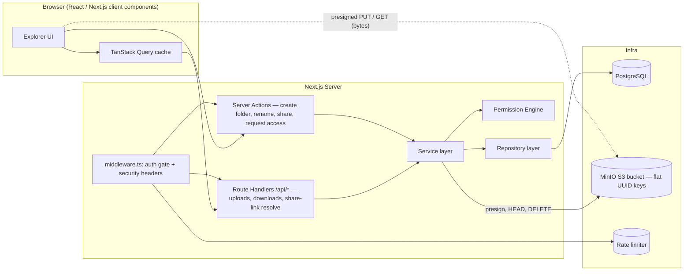

# DriveLite Architecture

## 1. High-Level Architecture

## 2. Core Principles
1. **Composite Node Pattern:** One table (`Node`) models both files and folders. Permissions, share links, and access requests all reference `Node`.
2. **Flat Object Storage:** All file bytes reside in MinIO under flat UUID keys (`crypto.randomUUID()`). Folder hierarchies exist only in PostgreSQL.
3. **Zero-Byte-Proxy:** Next.js never streams or proxies file bytes. Uploads and downloads execute directly between the browser and MinIO via signed URLs.
4. **Centralized Authorization:** Authorization is evaluated solely on the server via `PermissionEngine` (`src/server/permissions`), with the rule `VIEWER < EDITOR < OWNER`.
